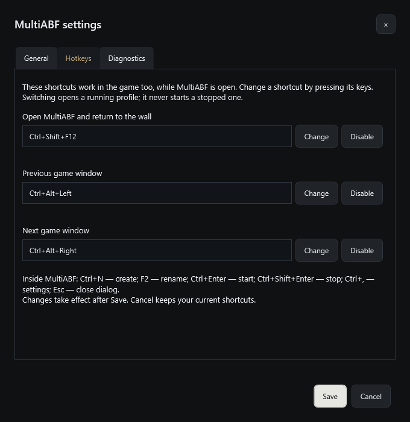
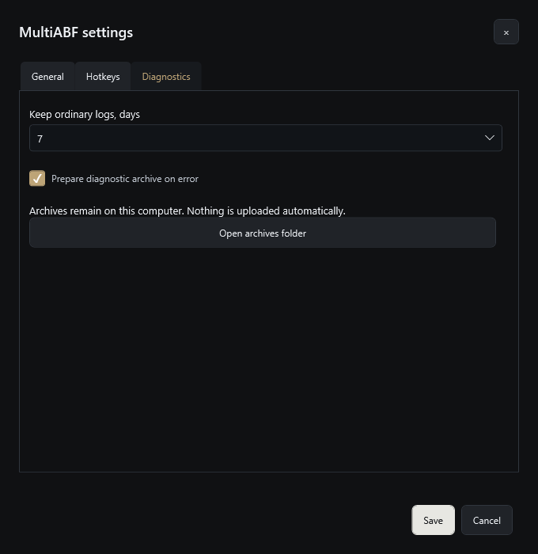

# MultiABF 1.0.0 — user guide

[Overview and download](README.md) · [Risks and warnings](RISKS.md) · [DPB details](DPB.md) · [Data and backup](DATA.md)

Button names below follow the English interface. Change the language under **Settings → General → Language**; Russian is also available.

## Install and update MultiABF

Download the EXE and checksum file from the [official release](https://github.com/firerister-ops/MultiABF-Releases/releases/tag/v1.0.0). Keep the EXE in a permanent local folder. To check the downloaded file in PowerShell, run `Get-FileHash -Algorithm SHA256 'C:\Tools\MultiABF\MultiABF.exe'` using your actual path, then compare the result with SHA256SUMS.txt.

On first run, complete prerequisite setup. MultiABF bundles its .NET runtime and the pinned Sandboxie installer. If Visual C++ x64 Runtime is missing or too old, its pinned Microsoft installer is downloaded and checked. Windows may request elevation for installation. Do not disable system protection to dismiss a warning; verify the download source and read the [risk notes](RISKS.md).

To replace MultiABF with a newer release, stop its managed profiles and close the application first. Back up the active data folder, replace the EXE, then reopen it. Game and DPB paths are specific to this PC. Copying an EXE to another computer does not migrate protected credentials or Windows accounts.

## General settings

Open **Settings → General**, change values and press **Save**. **Cancel** leaves the saved settings unchanged. Scroll inside the General tab to reach controls below the executable paths.

| Setting | Meaning / default |
| --- | --- |
| PoE1 executable | Select the installed PoE1 client/standalone launcher EXE. Required for new PoE1 profiles. |
| DPB1 executable (optional) | Select your PoE1 DPB EXE. Leave empty when not using DPB1. |
| PoE2 executable | Select the installed PoE2 client/standalone launcher EXE. Required for new PoE2 profiles. |
| DPB2 executable (optional) | Select your PoE2 DPB EXE. DPB1 and DPB2 are different installations. |
| Automatically update the game | **On** by default. The official standalone launcher checks/updates the common installation before a profile starts. This does not update DPB or plugins. Steam installations use Steam's updater. |
| Language | English on a new installation; English or Russian. Existing saved selections are preserved. |
| Minimize to tray when opening a game | **Off** by default: MultiABF remains in the taskbar. Applies when the next game view opens. |
| Active window size, % of screen | **100**, range **25–100**. Controls the interactive view size, not the profile's game render resolution. |
| Open data folder | Opens the active profile/settings/log/diagnostic storage location. |

Paths are stored as absolute paths. Select the installation on the current computer rather than copying another machine's path. Existing profiles retain their game selection; changing global paths does not convert a PoE1 profile into PoE2.

### Game update behavior

An update affects the shared installed game outside Sandboxie. Profiles using the same installation wait for one update. If any client is using that installation, including one started manually, MultiABF shows why it cannot update and offers retry; it does not close that client. Close it yourself only when appropriate, then retry.

Startup displays checking/updating/error stages and available launcher progress. Cancel prevents the profile from starting, while an ongoing update is allowed to finish safely. Access errors and damaged files are reported as errors, not silently treated as a required update. A game update can change compatibility with Sandboxie, DPB or plugins.

## Create and configure a profile

Select **Create profile**, enter a recognizable name and choose a game. Press **Create** to save it or **Cancel** to discard. For an existing stopped profile, use the gear button on its card and press **Save** after editing. Stop the profile before changing launch-sensitive settings.

| Tab | Controls and behavior |
| --- | --- |
| Game | Choose PoE1/PoE2 when creating a profile. Select a resolution preset or enter width/height. Default **1600 × 900**, foreground **30 FPS**, background **10 FPS**. Each FPS limit accepts **1–240**. |
| Connection | Optional **Use SOCKS5**, address, port, username and password. Disabled by default. Empty password input when editing keeps the saved password. Connection availability and actual game routing are separate checks. |
| Windows | Optional **Separate standard Windows user**, disabled by default. An optional account name is available. This experimental mode creates/uses an application-managed account and takes longer to prepare. It is not a separate OS or VM. |
| Resources | Optional CPU cap **1–100%** and memory cap **256–1,048,576 MiB**. Both limits are off by default. A low memory cap can prevent startup or cause termination; a cap does not reserve RAM. |

Each profile keeps its generated identifiers and settings across restarts. **Copy** creates another profile with its own identifiers. Renaming does not generate a new identity. Do not manually swap account bindings or profile folders between machines; see [data storage](DATA.md).

## Window wall and profile actions

Choose **Auto** or a fixed grid at the top of the wall. Profiles can be selected using their checkboxes for available group actions. The card's top-right buttons provide Start/Stop, DPB, settings, copy, diagnostics and delete. A narrow card may place actions in an overflow menu. Hover over an icon for its label.

| Action / indicator | Result |
| --- | --- |
| Start | Prepares the saved profile and launches its managed game. Wait for completion; repeated clicks are not needed. |
| Stop | Stops this profile's managed game and DPB. Wait until the stopped state before editing/deleting it. |
| DPB | Starts the configured matching DPB for an already running game. It passes the game PID/private configuration; it does not start a bot. |
| Open a running preview | Enters interactive mode for that game. Use the frame controls or return shortcut to go back to the wall. |
| Copy | Creates a separate saved profile with new identifiers. It is not a second view of the same process. |
| Diagnostics | Opens operations for that profile. |
| Delete | Requires a stopped profile and confirmation. Removes owned profile data and any Windows account created for it. This is not just hiding the card. |
| Bottom-left status | Game PID, CPU, RAM, per-game GPU and DPB state. **—** means a metric is unavailable; it is not zero. |
| Bottom-right status | Running, stopped or error state of the profile. |
| Header metrics | Overall CPU/RAM/GPU/VRAM use on the PC and the running-profile count. These include work outside this application. |

The active game view appears in Alt+Tab. Choosing it restores interactive handling. The frame buttons remain available for switching/return. If a game is unresponsive, return to the wall and inspect Diagnostics rather than repeatedly sending input.

## Hotkeys

Open **Settings → Hotkeys**, choose **Change**, press the desired combination and **Save**. **Disable** turns a binding off; **Cancel** preserves existing bindings. Global bindings work while MultiABF is open, including while a game is focused. Conflicts with another application's hotkeys can prevent registration.

| Default shortcut | Action |
| --- | --- |
| Ctrl+Shift+F12 | Open MultiABF and return to the wall. |
| Ctrl+Alt+Left | Open the previous running game window. |
| Ctrl+Alt+Right | Open the next running game window. |
| Ctrl+N | Create a profile while in MultiABF. |
| F2 | Rename the selected profile. |
| Ctrl+Enter | Start selected profiles. |
| Ctrl+Shift+Enter | Stop selected profiles. |
| Ctrl+, | Open settings. |
| Esc | Close the current dialog. |

Previous/next switching never starts a stopped profile.

## DPB setup

Install DPB and its required plugins separately, configure **DPB1** or **DPB2** in General, start the matching game profile, then press its **DPB** button. Allow elevation if requested. Sign-in and bot/plugin configuration remain your responsibility. MultiABF does not need ControlPanel to perform this launch.

Each profile receives private DPB components/settings; the selected source installation is preserved. The DPB status distinguishes startup, running process and observed connection. Connection is not a guarantee that every plugin is ready or a bot can run safely. Missing game keyboard sections can be copied from the ordinary config without transferring login data or overwriting existing bindings. Read the [DPB guide](DPB.md) for details.

## Diagnostics and bug reports

**Diagnostics** is available from the toolbar and each profile card. Search operations, choose a profile and a result/error filter, then expand **Stages** or **Technical details** for context. **Refresh** updates the list. **Save archive** creates a local diagnostic ZIP; **Open folder** opens its location.

Under **Settings → Diagnostics**, select ordinary-log retention: **7** days by default, or **14 / 30 / 90**. **Prepare diagnostic archive on error** is on by default. These archives stay on this computer; automatic preparation is not automatic upload. Unresolved recovery evidence is retained separately.

To contact the ABF service, select **Report a problem** (the toolbar button is labelled **Report bug**), describe the problem and select the entire application or one profile. Include steps, expected behavior, actual behavior and approximate time. Do not type passwords, tokens or account recovery information.

Press **Send** to prepare and upload the report. The attachment includes MultiABF version, recent event times/types, operation/profile IDs, error codes and your description. Game logs, screenshots, passwords and settings are not collected by this form. The server returns a report number on success. If delivery fails, the archive stays locally and the form allows manual retry; **Open folder** lets you find it. The application does not upload reports in the background.

## Exit, delete and move to another PC

Normal close cancels unfinished starts and stops the application's managed games and DPB processes. It shows shutdown progress. If cleanup fails, MultiABF stays open with an error so you can inspect it. Independently launched processes are outside its managed lifecycle. Forced termination or a system crash does not run the same graceful-close sequence.

Delete only after Stop completes. Read the confirmation: owned files/configuration and an application-created Windows user are removed. Shared dependencies and other profiles are retained. Locked files or incomplete ownership/cleanup cause an error; resolve the obstruction before retrying.

Back up the active data directory while profiles are stopped and MultiABF is closed. Windows Credential Manager secrets and managed-account credentials are machine-bound; a folder backup is not a portable clone of those accounts. On another PC choose its own executable paths and create its own profiles. See [DATA.md](DATA.md) and [RISKS.md](RISKS.md).
