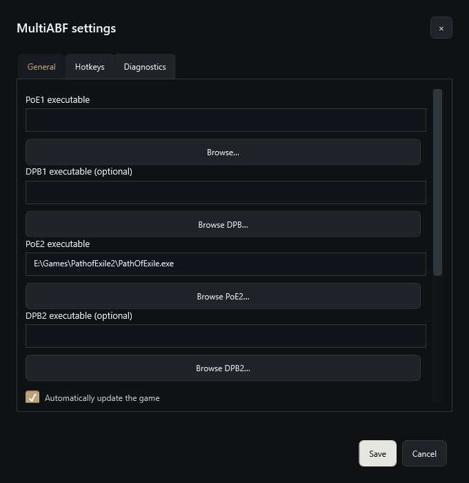
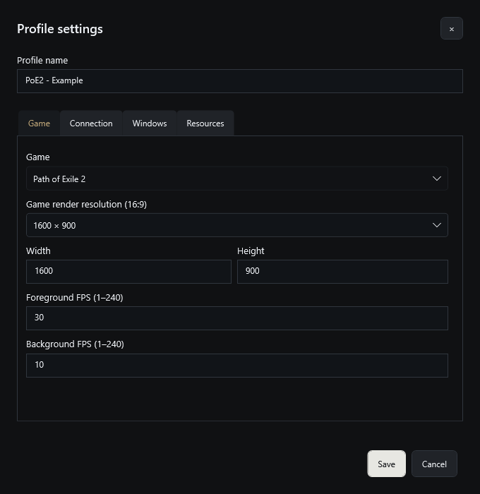
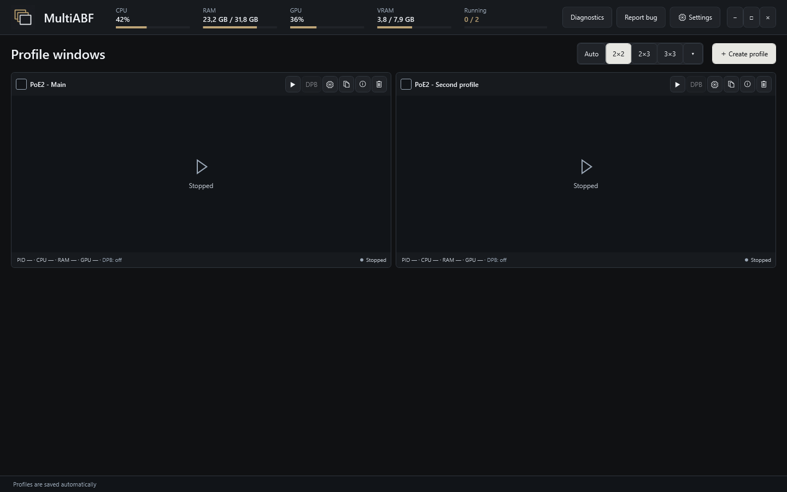
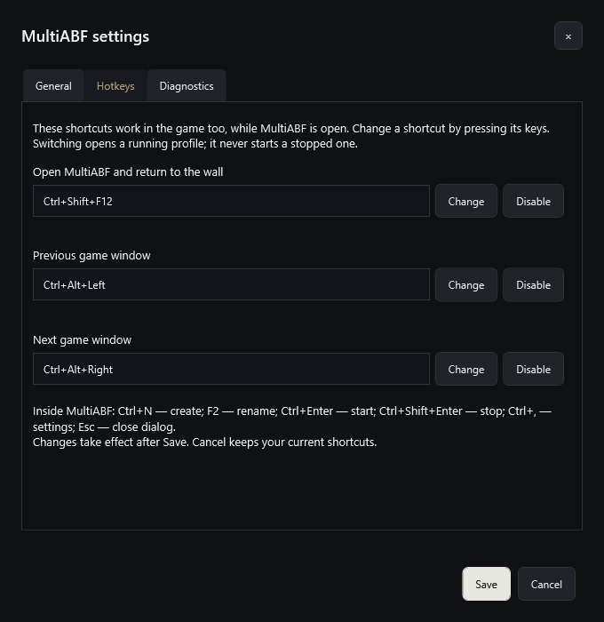
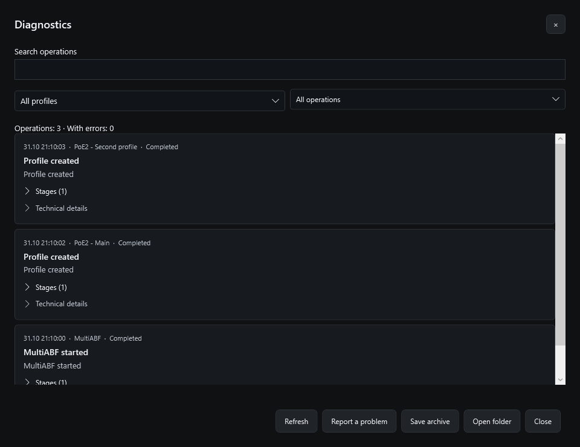
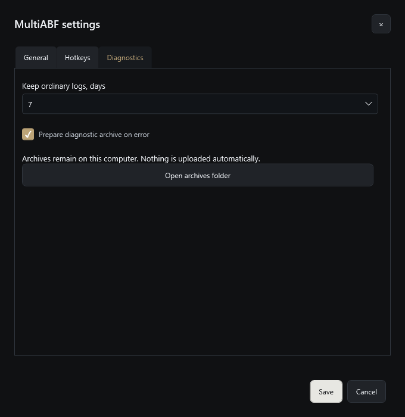
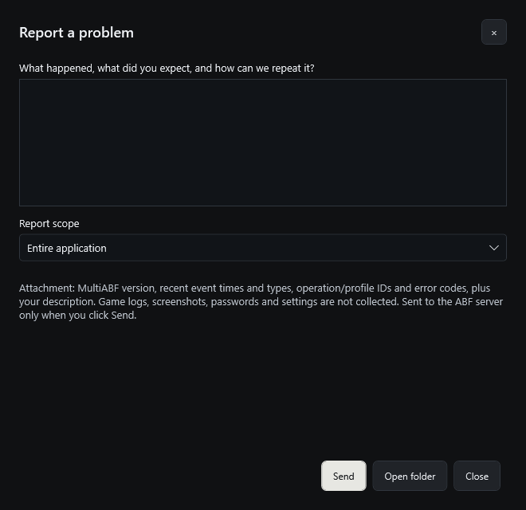

# MultiABF — user guide

[Overview and download](README.md) · [Risks and warnings](RISKS.md) · [DPB details](DPB.md) · [Data and backup](DATA.md)

Button names below follow the English interface. Change the language under **Settings → General → Language**; Russian is also available.

## Install and update MultiABF

Download the EXE and checksum file from [official releases](https://github.com/firerister-ops/MultiABF-Releases/releases). Beta builds are marked pre-release. Keep the EXE in a permanent local folder. To check the downloaded file in PowerShell, run `Get-FileHash -Algorithm SHA256 'C:\Tools\MultiABF\MultiABF.exe'` using your actual path, then compare the result with SHA256SUMS.txt.

On first run, complete prerequisite setup. MultiABF bundles its .NET runtime and the pinned Sandboxie installer. If Visual C++ x64 Runtime is missing or too old, its pinned Microsoft installer is downloaded and checked. Windows may request elevation for installation. Do not disable system protection to dismiss a warning; verify the download source and read the [risk notes](RISKS.md).

In **1.0.6**, Sandboxie is optional and is not installed at startup. Enable
the mode in General settings and press **Install components** to install it.
Direct profiles work without it; saved Sandboxie profiles keep their backend.
In a stopped profile's settings, the Sandboxie selection chooses that backend;
turn it off for Direct. Separate Windows users remain a separate profile choice.
Unavailable optional Direct channels appear as warnings; they are not certified
as active. Required launch/privacy/proxy failures still block startup.

To replace MultiABF with a newer release, stop its managed profiles and close the application first. Back up the active data folder, replace the EXE, then reopen it. Game and DPB paths are specific to this PC. Copying an EXE to another computer does not migrate protected credentials or Windows accounts.

## Profile identifiers (1.0.8)

Hover over **ID** before a profile name for a compact CPU/GPU/RAM and channel summary. **✓ Checked** means matching preparation evidence is saved; **• Saved** means assigned values are available without that check; **○ Native / Off** means that channel uses the original value; **! Check needed** means data is unavailable or a check needs attention. An amber badge identifies a missing ID assignment. This view does not re-check a running game or change its identity.

Click **ID**, or focus it and press Enter/Space, to open the details window. Expand the group you need, scroll with the mouse wheel or scrollbar, and select values to copy them. Close or Escape dismisses the window without saving changes. Groups needing attention start expanded.

The interface count comes from the Windows interface table and can include VPN, virtual, miniport, loopback and system entries. It is not a count of physical network cards created by MultiABF. Several interfaces can reference the same network association GUID; repeated values are displayed once with the complete interface list.

Preparation saves the full available list locally. Older profiles may need a new preparation before their individual storage-device and network GUID values are available. Changed assignments/settings require a fresh preparation. The list is excluded from diagnostic reports. See [Data storage](DATA.md) for its location.

New automatic Direct profiles select the complete supported identity bundle, including CPU brand, GPU description, Vulkan device UUID and Windows group/owner. Current Windows users, including administrators, are supported; a separate standard account remains an optional choice. Copies receive independent values and retain the source profile's explicit channel selections. Existing profiles are not silently migrated or switched on.

CPU brand support is bound to verified game builds. A game update can require a new MultiABF compatibility update; unknown builds are rejected rather than using old instruction addresses. Changing the CPU brand does not change its capabilities, topology or physical speed. GPU description changes preserve physical adapter selection and capabilities. Preparation checks and actual game getter observations are separate evidence.

## General settings

Open **Settings → General**, change values and press **Save**. **Cancel** leaves the saved settings unchanged. Scroll inside the General tab to reach controls below the executable paths.

| Setting | Meaning / default |
| --- | --- |
| PoE1 executable | Select the installed PoE1 client/standalone launcher EXE. Required for new PoE1 profiles. |
| DPB1 executable (optional) | Select your PoE1 DPB EXE. Leave empty when not using DPB1. |
| PoE2 executable | Select the installed PoE2 client/standalone launcher EXE. Required for new PoE2 profiles. |
| DPB2 executable (optional) | Select your PoE2 DPB EXE. DPB1 and DPB2 are different installations. |
| Automatically update the game | **On** by default. The official standalone launcher checks/updates the common installation before a profile starts. This does not update DPB or plugins. Steam installations use Steam's updater. |
| Language | English on a new installation; English or Russian. Existing saved selections are preserved. |
| Minimize to tray when opening a game | **Off** by default: MultiABF remains in the taskbar. Applies when the next game view opens. |
| Active window size, % of screen | **100**, range **25–100**. Controls the interactive view size, not the profile's game render resolution. |
| Open data folder | Opens the active profile/settings/log/diagnostic storage location. |

Paths are stored as absolute paths. Select the installation on the current computer rather than copying another machine's path. Existing profiles retain their game selection; changing global paths does not convert a PoE1 profile into PoE2.

### GPU and memory controls

**Distribute Direct clients across GPUs** is disabled by default. When enabled, DirectX 11/12 launches reserve a dedicated GPU before the game resumes. Pending launches and clients with cached rendering count toward distribution; different VRAM capacities are weighted. Disable this option for Vulkan. It assigns new clients; it does not move an already running client to another card or continuously balance measured GPU utilization.

Open the **Memory** tab for the active Windows pagefile size, next-startup configuration and committed memory. **Grow pagefile when memory is insufficient** is enabled by default, with a **128 GiB** automatic growth limit; the accepted limit range is **32–128 GiB**. Growth requires the normal Windows administrative helper and available disk space. If memory remains insufficient or the limit is reached, queued launches wait.

To reduce the file, stop profiles and the launch queue, select **32–128 GiB**, then choose **Save reduction for Windows restart**. This action saves separately from the normal settings Save, disables automatic growth and sets its limit to the chosen size. Windows applies a reduction at the next startup; the active file is not immediately shrunk and MultiABF does not reboot the PC.

### Game update behavior

An update affects the shared installed game outside Sandboxie. Profiles using the same installation wait for one update. If any client is using that installation, including one started manually, MultiABF shows why it cannot update and offers retry; it does not close that client. Close it yourself only when appropriate, then retry.

Startup displays checking/updating/error stages and available launcher progress. Cancel prevents the profile from starting, while an ongoing update is allowed to finish safely. Access errors and damaged files are reported as errors, not silently treated as a required update. A game update can change compatibility with Sandboxie, DPB or plugins.

## Create and configure a profile

Select **Create profile**, enter a recognizable name and choose a game. Press **Create** to save it or **Cancel** to discard. For an existing stopped profile, use the gear button on its card and press **Save** after editing. Stop the profile before changing launch-sensitive settings.

| Tab | Controls and behavior |
| --- | --- |
| Game | Choose PoE1/PoE2 when creating a profile. Select a resolution preset or enter width/height. Default **1600 × 900**, foreground **30 FPS**, background **10 FPS**. Each FPS limit accepts **1–240**. |
| Connection | Optional **Use SOCKS5**, address, port, username and password. Disabled by default. Empty password input when editing keeps the saved password. Connection availability and actual game routing are separate checks. |
| Windows | Optional **Separate standard Windows user**, disabled by default. An optional account name is available. This experimental mode creates/uses an application-managed account and takes longer to prepare. It is not a separate OS or VM. |
| Resources | Optional CPU cap **1–100%** and memory cap **256–1,048,576 MiB**. Both limits are off by default. A low memory cap can prevent startup or cause termination; a cap does not reserve RAM. |

Each profile keeps its generated identifiers and settings across restarts. **Copy** creates another profile with its own identifiers. Renaming does not generate a new identity. Do not manually swap account bindings or profile folders between machines; see [data storage](DATA.md).

## Window wall and profile actions

Choose **Auto** or a fixed grid at the top of the wall. Profiles can be selected using their checkboxes for available group actions. The card's top-right buttons provide Start/Stop, DPB, settings, copy, diagnostics and delete. A narrow card may place actions in an overflow menu. Hover over an icon for its label.

| Action / indicator | Result |
| --- | --- |
| Start | Prepares the saved profile and launches its managed game. Wait for completion; repeated clicks are not needed. |
| Stop | Stops this profile's managed game and DPB. Wait until the stopped state before editing/deleting it. |
| DPB | Starts the configured matching DPB for an already running game. It passes the game PID/private configuration; it does not start a bot. |
| Open a running preview | Enters interactive mode for that game. Use the frame controls or return shortcut to go back to the wall. |
| Copy | Creates a separate saved profile with new identifiers. It is not a second view of the same process. |
| Diagnostics | Opens operations for that profile. |
| Delete | Requires a stopped profile and confirmation. Removes owned profile data and any Windows account created for it. This is not just hiding the card. |
| Bottom-left status | Game PID, CPU, RAM, per-game GPU and DPB state. **—** means a metric is unavailable; it is not zero. |
| Bottom-right status | Running, stopped or error state of the profile. |
| Header metrics | Overall CPU/RAM/GPU/VRAM use on the PC and the running-profile count. These include work outside this application. |

The active game view appears in Alt+Tab. Choosing it restores interactive handling. The frame buttons remain available for switching/return. If a game is unresponsive, return to the wall and inspect Diagnostics rather than repeatedly sending input.

## Hotkeys

Open **Settings → Hotkeys**, choose **Change**, press the desired combination and **Save**. **Disable** turns a binding off; **Cancel** preserves existing bindings. Global bindings work while MultiABF is open, including while a game is focused. Conflicts with another application's hotkeys can prevent registration.

| Default shortcut | Action |
| --- | --- |
| Ctrl+Shift+F12 | Open MultiABF and return to the wall. |
| Ctrl+Alt+Left | Open the previous running game window. |
| Ctrl+Alt+Right | Open the next running game window. |
| Ctrl+N | Create a profile while in MultiABF. |
| F2 | Rename the selected profile. |
| Ctrl+Enter | Start selected profiles. |
| Ctrl+Shift+Enter | Stop selected profiles. |
| Ctrl+, | Open settings. |
| Esc | Close the current dialog. |

Previous/next switching never starts a stopped profile.

## DPB setup

Install DPB and its required plugins separately, configure **DPB1** or **DPB2** in General, start the matching game profile, then press its **DPB** button. Allow elevation if requested. Sign-in and bot/plugin configuration remain your responsibility. MultiABF does not need ControlPanel to perform this launch.

Each profile receives private DPB components/settings; the selected source installation is preserved. The DPB status distinguishes startup, running process and observed connection. Connection is not a guarantee that every plugin is ready or a bot can run safely. Missing game keyboard sections can be copied from the ordinary config without transferring login data or overwriting existing bindings. Read the [DPB guide](DPB.md) for details.

## Diagnostics and bug reports

**Diagnostics** is available from the toolbar and each profile card. Search operations, choose a profile and a result/error filter, then expand **Stages** or **Technical details** for context. **Refresh** updates the list. **Save archive** creates a local diagnostic ZIP; **Open folder** opens its location.

Under **Settings → Diagnostics**, select ordinary-log retention: **7** days by default, or **14 / 30 / 90**. **Prepare diagnostic archive on error** is on by default. These archives stay on this computer; automatic preparation is not automatic upload. Unresolved recovery evidence is retained separately.

In **1.0.6**, **Automatically send blocking-error reports** is enabled by
default and can be disabled in Settings. Failed create/prepare/start/stop
operations, unexpected managed-process exits and unhandled application errors
send the existing filtered diagnostic package in the background. Automatic
reports contain no screenshots. A failed upload keeps its package for retry;
the diagnostics view shows delivery status and the report number.

To contact the ABF service, select **Report a problem** (the toolbar button is labelled **Report bug**), describe the problem and select the entire application or one profile. Include steps, expected behavior, actual behavior and approximate time. Do not type passwords, tokens or account recovery information.

Version **1.0.7** adds owned game exit codes/times, recent window and render/cache state, actual cancellation Stop outcomes and bounded redacted text from official-updater error dialogs. No memory dumps, game images or complete game logs are included. Missing data is marked unavailable.

Press **Send** to prepare and upload the report. The attachment includes MultiABF version, recent event times/types, operation/profile IDs, error codes and your description. Game logs, screenshots, passwords and settings are not collected by this form. The server returns a report number on success. If delivery fails, the archive stays locally and the form allows manual retry; **Open folder** lets you find it. Manual reports are sent after pressing Send; automatic blocking-error reports follow the separate setting described above.

## Exit, delete and move to another PC

Normal close cancels unfinished starts and stops the application's managed games and DPB processes. It shows shutdown progress. If cleanup fails, MultiABF stays open with an error so you can inspect it. Independently launched processes are outside its managed lifecycle. Forced termination or a system crash does not run the same graceful-close sequence.

Delete only after Stop completes. Read the confirmation: owned files/configuration and an application-created Windows user are removed. Shared dependencies and other profiles are retained. Locked files or incomplete ownership/cleanup cause an error; resolve the obstruction before retrying.

Back up the active data directory while profiles are stopped and MultiABF is closed. Windows Credential Manager secrets and managed-account credentials are machine-bound; a folder backup is not a portable clone of those accounts. On another PC choose its own executable paths and create its own profiles. See [DATA.md](DATA.md) and [RISKS.md](RISKS.md).

## Background rendering and cached frames

Under the profile's **Settings → Game**, after the FPS controls, **Disable rendering
in the background** is Off by default. Save enables it for that profile only;
it can also be changed while that profile is running. Other running-profile
settings remain read-only.

For the verified PoE1 3.29.3c DX11 build in Direct mode, MultiABF obtains a real
frame and then suppresses native rendering while the client is on the wall.
The tile shows **Cache · time**. This is a static image. **Open** restores rendering;
returning to the wall obtains a fresh frame. Stop/new launch invalidates the old
cache. Cached pictures are held in memory rather than saved between launches.
An explicit diagnostic snapshot request can still save its requested image.

PoE2, unsupported images/renderers and active managed DPB retain ordinary
rendering with a status explaining the limitation. A failed capture leaves
rendering On; a failed restore is shown as an error. The mode does not change
monitor configuration, log into the game or block official game updates.
GPU savings do not establish RAM/VRAM savings or a fixed number of in-game clients.
