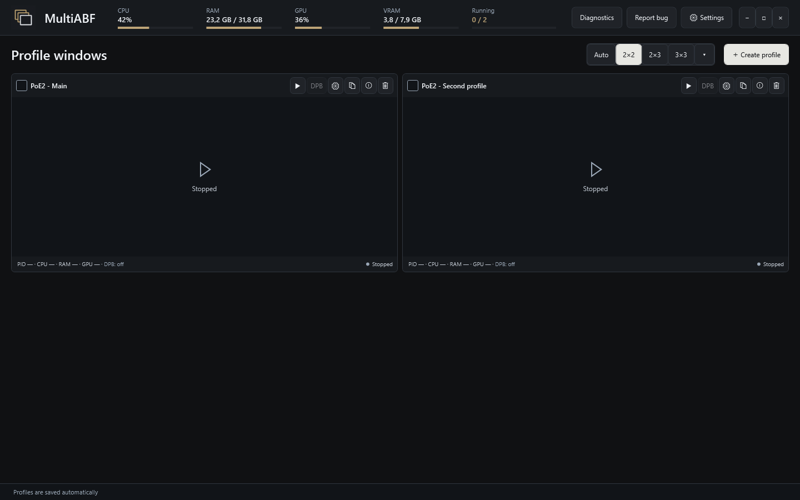
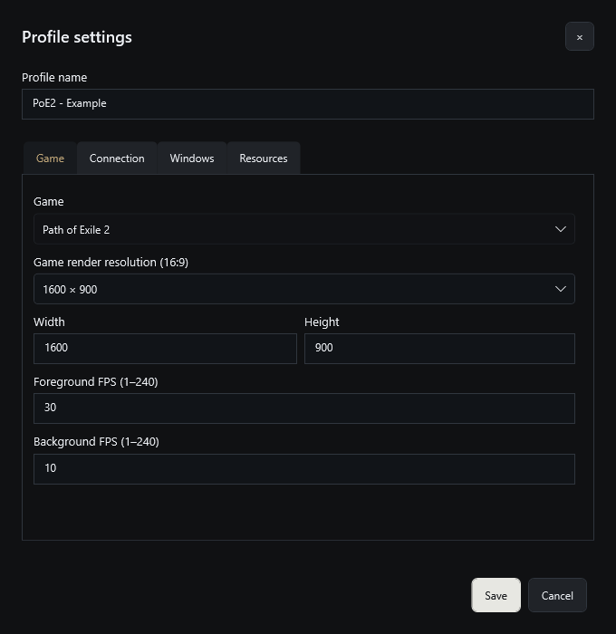
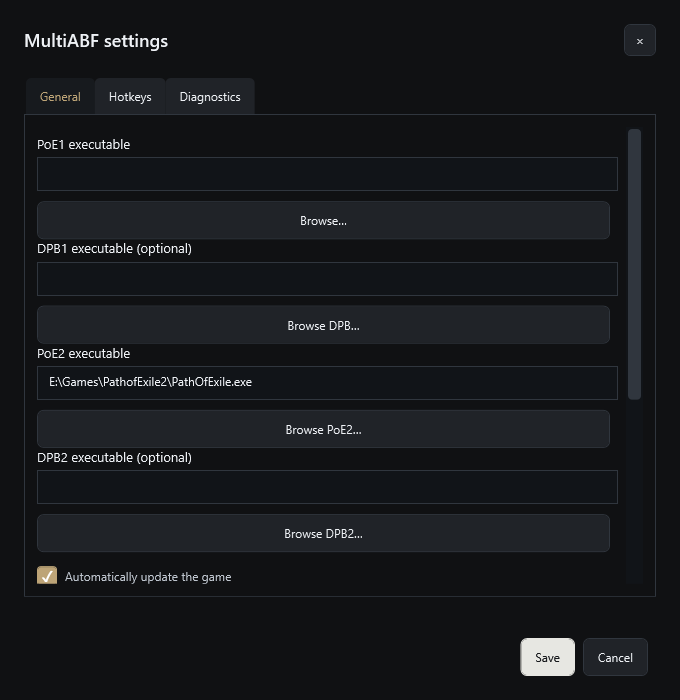
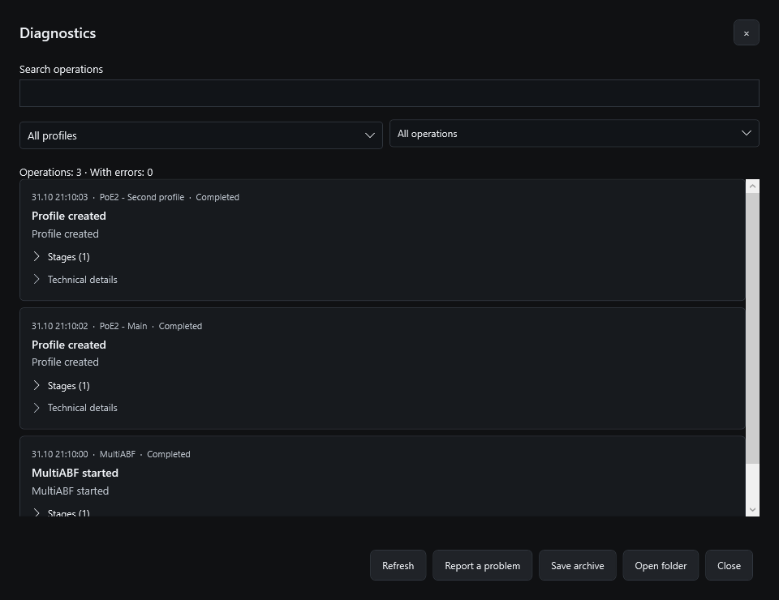
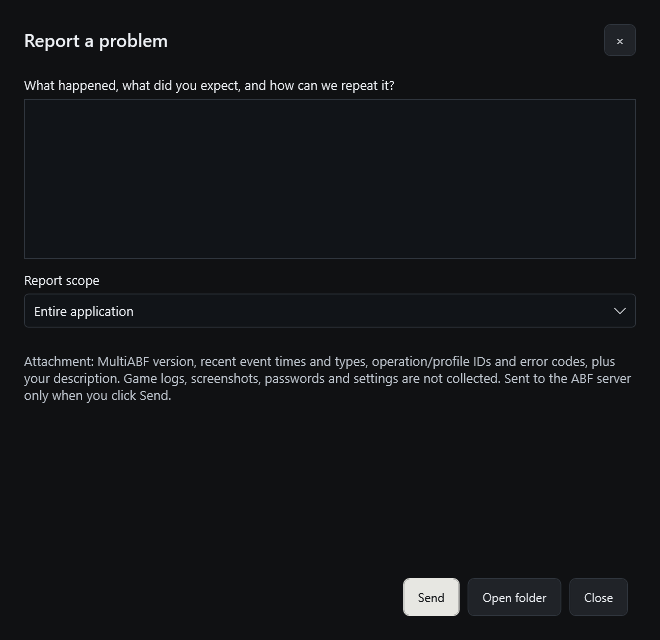

  

<h1 align="center">MultiABF</h1>

<strong>One workspace for independent Path of Exile 1 and Path of Exile 2 windows.</strong>

MultiABF is a Windows desktop application for creating persistent game profiles, launching them in Sandboxie containers and switching between their windows from a single overview. Each profile keeps its own settings and generated identity. Optional DPB integration starts the matching DPB installation for that profile.

**[Download MultiABF 1.0.0](https://github.com/firerister-ops/MultiABF-Releases/releases/tag/v1.0.0)** · [User guide](GUIDE.md) · [Risks and limitations](RISKS.md) · [DPB setup](DPB.md) · [Data storage](DATA.md) · [Troubleshooting](TROUBLESHOOTING.md)

> Read the [risks](RISKS.md) before using game accounts. MultiABF does not guarantee protection from account sanctions, anonymity or compatibility with every game/DPB/plugin update. DPB is installed separately; MultiABF does not automatically press Start in a bot.

## Features

| Feature | What you can do |
| --- | --- |
| PoE1 and PoE2 | Keep separate PoE1/DPB1 and PoE2/DPB2 executable paths and choose a game for each new profile. |
| Persistent profiles | Create, rename, copy and delete profiles. Saved profile identifiers survive restarts; a copy receives its own identifiers. |
| Profile isolation | Use Sandboxie containers with profile-specific game configuration and generated hardware/Windows identity values. Optional separate standard Windows users provide an additional account boundary. |
| Window wall | Select a grid, see window previews and open a running game for direct interaction. Actions stay at the top right of each card. |
| Live status | See the game PID, CPU, RAM, per-game GPU usage when available and DPB state in one line. The header shows overall machine load. |
| Window switching | Return to the wall, move to the previous/next running window, change hotkeys and set the active-window size. The active game view participates in Alt+Tab. |
| Per-profile display | Set resolution and separate foreground/background FPS limits. |
| Optional SOCKS5 | Configure a separate connection for a profile, including authentication. Connection checks and the actual game-route check are distinct. |
| Resource limits | Optionally cap CPU and memory use for a profile. Limits do not reserve resources or guarantee a particular FPS. |
| DPB integration | Launch the appropriate DPB against the managed game PID with private per-profile components/settings. ControlPanel is not required. |
| Game updates | Use the official standalone launcher to check/update the shared game installation before startup. Running clients block updates rather than being closed. |
| Diagnostics | Browse operations, filter by profile/result, search, expand stages and technical details, and save an archive. |
| Manual bug reports | Describe a problem and send a small diagnostic attachment to the ABF server. No automatic report upload; a failed delivery leaves the archive locally. |
| Managed cleanup | Stop a profile with its DPB. Normal application exit stops managed profiles. Delete a stopped profile together with its owned data and application-created Windows account. |

## Start in five steps

1. Download **MultiABF.exe** and **SHA256SUMS.txt** from the release. Compare the checksum and put the EXE in a permanent folder.
2. Run MultiABF. Allow required prerequisite/driver setup. The EXE includes .NET and the pinned Sandboxie installer; a missing supported Visual C++ runtime is downloaded from Microsoft and verified before installation.
3. Open **Settings → General**. Select your game executable and, if used, its matching DPB executable. These must be paths on this computer.
4. Select **Create profile**, choose the game and display settings, then **Create**. Creation saves the profile; it does not start the game.
5. Press the profile's **Start** button. Wait for startup to finish, open its window, then sign in directly in the game. Use **DPB** only if you want to launch DPB. Bot Start remains a separate action.

Read the [full user guide](GUIDE.md) for every setting, hotkey, shutdown/deletion behavior and troubleshooting steps.

## Interface

Screenshots show the actual **1.0.0** release in **English**, captured through its UI snapshot API using an isolated demonstration data directory. Profiles are stopped; these are interface examples, not gameplay or performance evidence. No account credentials or live player windows are shown.

| Profile setup | General settings |
| --- | --- |
|  |  |

| Diagnostics | Report a problem |
| --- | --- |
|  |  |

## Requirements and compatibility

- Windows x64, Windows 10 build 19041 or later, with Windows Graphics Capture support. Actual capacity depends on RAM, GPU, CPU and game settings.
- Separately installed PoE1 and/or PoE2. DPB and its plugins/license are optional and supplied separately.
- The pinned backend is Sandboxie core **5.73.4 / Plus 1.18.4**. An existing different Sandboxie version is not automatically replaced. Installation of drivers/services or managed Windows accounts can require administrator permission.
- First preparation is slower than reuse of a prepared profile; experimental separate-user mode can add substantial preparation time. No fixed launch time or client count is promised.

Verification includes PoE1 managed runs and PoE2/DPB2 SDK attachment on owned test machines. It does not prove all gameplay paths, every hardware identity surface or third-party plugin stability. See [known limits and warnings](RISKS.md).

## Reports, data and license

Use **Report a problem** in the main toolbar or Diagnostics. Include the expected result, what happened and reproduction steps. Save the returned report number. Read [what is attached](GUIDE.md#diagnostics-and-bug-reports) before submitting.

Profiles, settings and diagnostics live in the active data directory; **Settings → General → Open data folder** opens it. [Storage, backup and deletion details](DATA.md).

MultiABF is proprietary freeware. This public repository contains documentation and binary releases, not application source. See [LICENSE.txt](LICENSE.txt) and [THIRD_PARTY_NOTICES.txt](THIRD_PARTY_NOTICES.txt). Sandboxie's own license/certificate requirements still apply; see the [official certificate information](https://sandboxie-plus.com/contribute/).
